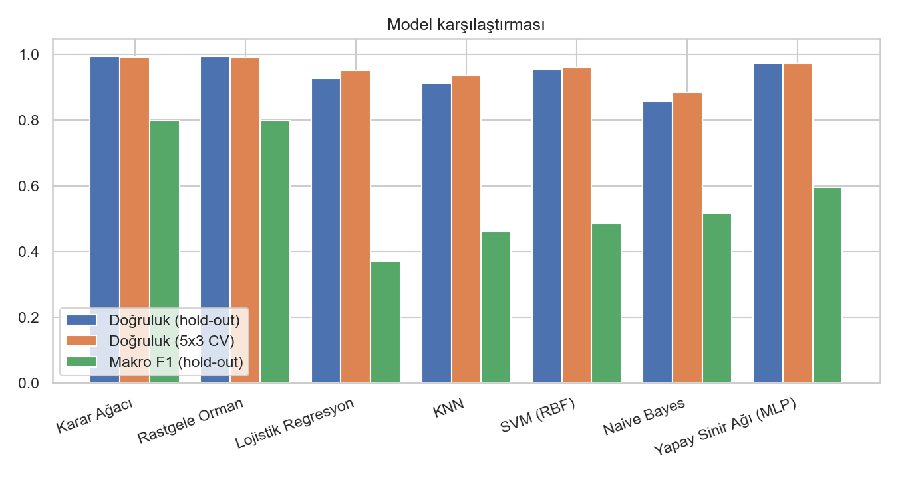
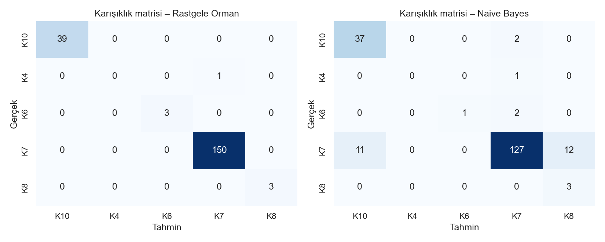
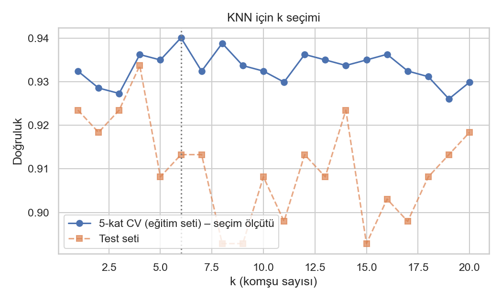
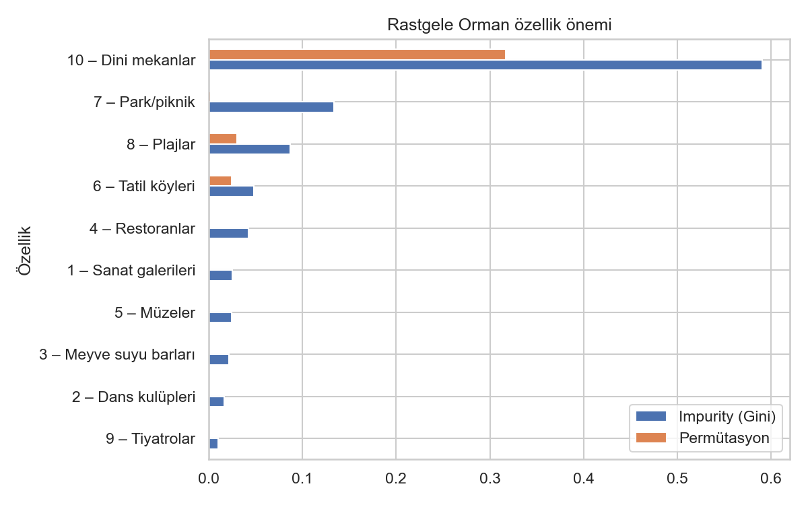
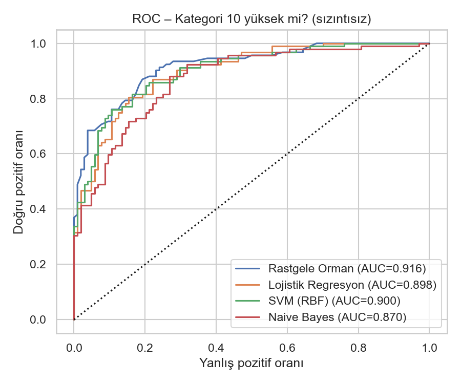
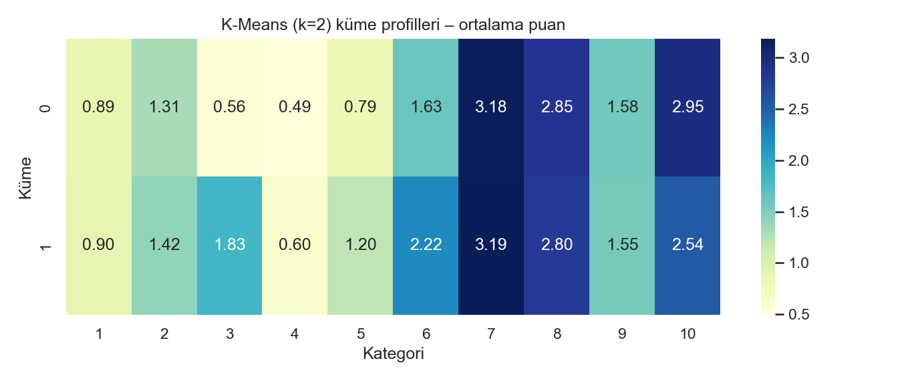

# TravelReviews: Makine Öğrenmesi ile Seyahat Memnuniyeti Tahmini

TripAdvisor kullanıcılarının 10 farklı mekân kategorisine verdiği puanlar üzerinde **7 makine öğrenmesi algoritmasını** çok ölçütlü ve istatistiksel olarak karşılaştıran bir veri bilimi projesi. Çalışma; sınıflandırma, etiket sızıntısı analizi, sızıntısız bir ikincil görev (sınıflandırma + regresyon) ve K-Means ile kullanıcı segmentasyonunu kapsar.

📄 **Akademik makale:** [Makale_Seyahat_Memnuniyeti_Tahmini.pdf](Makale_Seyahat_Memnuniyeti_Tahmini.pdf)



## Öne çıkanlar

- **7 algoritma:** Karar Ağacı, Rastgele Orman, Lojistik Regresyon, KNN, SVM (RBF), Naive Bayes, Yapay Sinir Ağı (MLP)
- **Geniş ölçüt seti:** doğruluk, dengeli doğruluk, makro kesinlik/duyarlılık/F1, ağırlıklı F1, MCC, Cohen kappa, log-loss; ikili görevde ROC-AUC, PR-AUC, Brier; regresyonda MAE/RMSE/R²; kümelemede Silhouette, Davies-Bouldin, Calinski-Harabasz
- **Sağlam değerlendirme:** 5×3 tekrarlı katmanlı çapraz doğrulama, Wilcoxon işaretli sıra testi, `Pipeline` ile sızıntısız ölçekleme, KNN `k` seçimi test seti yerine CV ile
- **Etiket sızıntısı analizi:** Hedef, girdilerin `argmax`'ı olduğundan eğitimsiz bir kural da %100 doğruluk verir; bu yüzden ek, sızıntısız bir görev kurulmuştur
- **Tamamen yeniden üretilebilir:** tek komutla tüm tablolar ve grafikler yeniden üretilir

## Veri Seti

[UCI Machine Learning Repository – Travel Reviews](https://archive.ics.uci.edu/ml/datasets/Travel+Reviews) (TripAdvisor kaynaklı).

| Özellik | Değer |
|---|---|
| Kullanıcı sayısı | 980 |
| Özellikler | 10 kategori, kullanıcı başına ortalama puan (0–4), eksik değer yok |
| Hedef (ana görev) | Kullanıcının en yüksek puan verdiği kategori (9 sınıf) |

Kategoriler: K1 sanat galerileri, K2 dans kulüpleri, K3 meyve suyu barları, K4 restoranlar, K5 müzeler, K6 tatil köyleri, K7 park/piknik, K8 plajlar, K9 tiyatrolar, K10 dini mekanlar.

Sınıf dağılımı çok dengesizdir: K7 %80,6 (790), K10 %16,4 (161), kalan yedi sınıf toplam 29 kullanıcı. K7 puanı neredeyse sabittir (std = 0,008).

## Sonuçlar

### 1) Ana görev: en yüksek puanlı kategoriyi tahmin (hold-out, n=196)

| Model | Doğruluk | Dengeli Doğr. | Makro F1 | MCC |
|---|---|---|---|---|
| Taban çizgisi (çoğunluk sınıfı) | 0,7653 | 0,2000 | 0,1734 | 0,0000 |
| Karar Ağacı | **0,9949** | **0,8000** | **0,7993** | **0,9863** |
| Rastgele Orman | **0,9949** | **0,8000** | **0,7993** | **0,9863** |
| Yapay Sinir Ağı (MLP) | 0,9745 | 0,5987 | 0,5967 | 0,9306 |
| SVM (RBF) | 0,9541 | 0,4589 | 0,4865 | 0,8731 |
| Lojistik Regresyon | 0,9286 | 0,3679 | 0,3718 | 0,7983 |
| KNN (k=6, CV ile seçildi) | 0,9133 | 0,4330 | 0,4610 | 0,7575 |
| Naive Bayes | 0,8571 | 0,6257 | 0,5169 | 0,6880 |

5×3 CV doğrulukları: Karar Ağacı 0,9925 ± 0,0049 · Rastgele Orman 0,9908 ± 0,0042 · MLP 0,9731 · SVM 0,9602 · Lojistik Regresyon 0,9520 · KNN 0,9364 · Naive Bayes 0,8854. Karar Ağacı ile Rastgele Orman arasındaki fark anlamlı değildir (Wilcoxon p = 0,28); Karar Ağacı'nın Lojistik Regresyon ve Naive Bayes'ten üstünlüğü anlamlıdır (p < 0,001). Tüm tablolar: [results/](results/).

| Karışıklık matrisleri | KNN için k seçimi |
|---|---|
|  |  |

> **Doğruluk yanıltıcıdır.** Naive Bayes doğrulukta son sırada olsa da dengeli doğrulukta KNN, SVM ve Lojistik Regresyon'u geçer; çünkü nadir sınıfları daha sık yakalar. Sıralamayı doğrulukla değil makro F1 / dengeli doğrulukla değerlendirin.

### 2) Etiket sızıntısı

Etiket girdilerin `argmax`'ı olduğu için **eğitimsiz "en yüksek puanlı kategoriyi seç" kuralı test kümesinde %100 doğruluk** verir. Yani %99,5'lik ağaç başarısı gizli bir örüntünün keşfi değil, bu kuralın yaklaşıklanmasıdır.



Gini önemine göre K10 (0,59) öne çıkar; permütasyon önemi de K10'u (0,317) doğrular. K7'nin Gini önemi yüksek, permütasyon önemi ise ihmal edilebilir düzeydedir (değeri neredeyse sabit) – Gini önemi sabite yakın özelliklerde yanıltıcı olabilir.

### 3) Sızıntısız görev: Kategori 10 puanı yüksek mi? (9 özellik → K10, 5×3 CV)

| Model | Doğruluk | F1 | ROC-AUC | PR-AUC | MCC | Brier |
|---|---|---|---|---|---|---|
| Rastgele Orman | **0,813** | **0,794** | **0,909** | **0,904** | **0,625** | **0,123** |
| MLP | 0,804 | 0,790 | 0,896 | 0,893 | 0,609 | 0,135 |
| SVM (RBF) | 0,797 | 0,786 | 0,895 | 0,892 | 0,594 | 0,133 |
| Lojistik Regresyon | 0,781 | 0,766 | 0,880 | 0,869 | 0,562 | 0,145 |
| Naive Bayes | 0,766 | 0,777 | 0,860 | 0,845 | 0,551 | 0,178 |
| KNN | 0,764 | 0,721 | 0,854 | 0,798 | 0,531 | 0,157 |
| Karar Ağacı | 0,762 | 0,744 | 0,760 | 0,676 | 0,522 | 0,238 |
| Taban çizgisi | 0,532 | 0,000 | 0,500 | 0,468 | 0,000 | 0,249 |

Regresyon olarak: Rastgele Orman R² = 0,70 (MAE 0,132), Ridge R² = 0,37 (MAE 0,201), ortalama taban çizgisi MAE 0,269. Kategori puanları gerçek bir tahmin sinyali taşır ve ilişki doğrusal değildir.



### 4) Kullanıcı segmentasyonu (K-Means)

Silhouette, Davies-Bouldin ve Calinski-Harabasz üçü de k = 2'yi destekler (Silhouette 0,264). Düşük Silhouette değeri kullanıcı profillerinin belirgin ayrışmadığını gösterir. İki küme (628 / 352 kullanıcı) en çok meyve suyu barı (K3), müze, tatil köyü ve dini mekân puanlarında ayrışır.



## Önceki sürüme göre düzeltmeler

- Ölçeklenmiş veri yalnızca KNN'de kullanılıyordu; artık tüm modeller `MinMaxScaler + model` **Pipeline**'ı ile eğitilir (ölçekleyici sadece eğitim verisine uydurulur).
- KNN için `k`, test doğruluğuna göre seçiliyordu; artık eğitim seti üzerinde 5 katlı CV ile seçilir.
- Yalnızca doğruluk raporlanıyordu; artık 8+ ölçüt, CV ve anlamlılık testi var.
- Notebook veriyi, depoda bulunmayan `tripadvisor_review.csv` dosyasından okuyordu; artık doğrudan `tripadvisor_review.xls` (içeriği CSV) okunur.
- Raporda geçen Yapay Sinir Ağı notebook'ta yoktu; artık eklendi (`MLPClassifier`).
- Rapordaki "2048 kullanıcı" ifadesi düzeltildi: veri setinde 980 kullanıcı vardır.
- Notebook tekrar eden kodlardan arındırılıp tek akışlı hale getirildi.

## Proje Yapısı

```
TravelReviews/
├── TravelReviewsDataScience.ipynb          # Çalıştırılmış, açıklamalı analiz defteri
├── src/experiments.py                      # Tüm deneyleri ve grafikleri üreten betik
├── tripadvisor_review.xls                  # Veri seti (uzantısı .xls olsa da içeriği CSV'dir)
├── results/                                # Metrik tabloları (CSV) ve summary.json
├── docs/images/                            # Grafikler
├── Makale_Seyahat_Memnuniyeti_Tahmini.pdf  # Akademik makale
├── requirements.txt
└── README.md
```

## Çalıştırma

```bash
git clone https://github.com/MelihAliCagman/TravelReviews.git
cd TravelReviews
pip install -r requirements.txt

# Tüm deneyleri çalıştır (results/ ve docs/images/ yeniden üretilir)
python src/experiments.py

# veya interaktif
jupyter notebook TravelReviewsDataScience.ipynb
```

Rastgelelik `random_state=42` ile sabitlenmiştir; aynı scikit-learn sürümünde sonuçlar birebir tekrarlanır.

## Sınırlılıklar

- Ana görevde etiket girdilerden türetildiği için model karşılaştırması algoritma üstünlüğünden çok karar sınırı geometrisine uyumu ölçer.
- Beş sınıfın en çok 2 örneği vardır; bu sınıflar için makro ölçütler yüksek varyanslıdır.
- KNN dışındaki modellerde hiperparametre araması yapılmamıştır (varsayılanlar kullanılmıştır).
- Veri yorum metni, zaman ya da konum içermez; yalnızca kullanıcı başına ortalama puanlardır.

## Kullanılan Teknolojiler

Python 3, pandas, NumPy, SciPy, scikit-learn, Matplotlib, Seaborn, Jupyter.

## Ekip

Gazi Üniversitesi Bilgisayar Mühendisliği bölümünde üç kişilik ekiple geliştirilmiştir.
